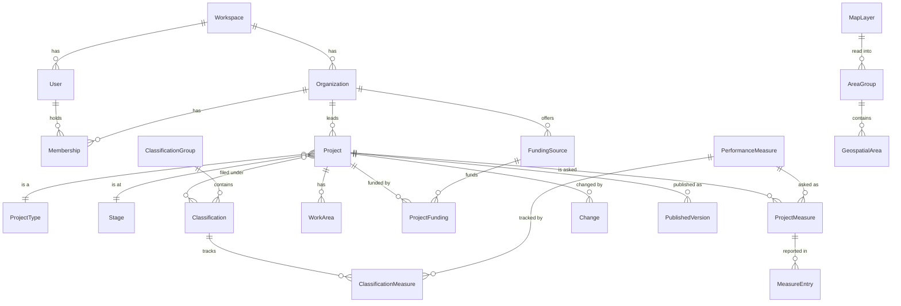
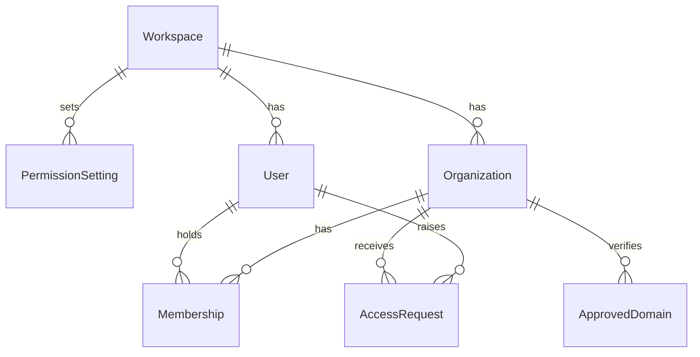
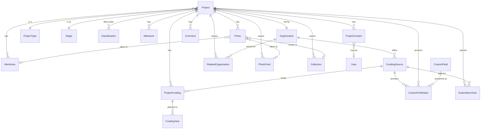
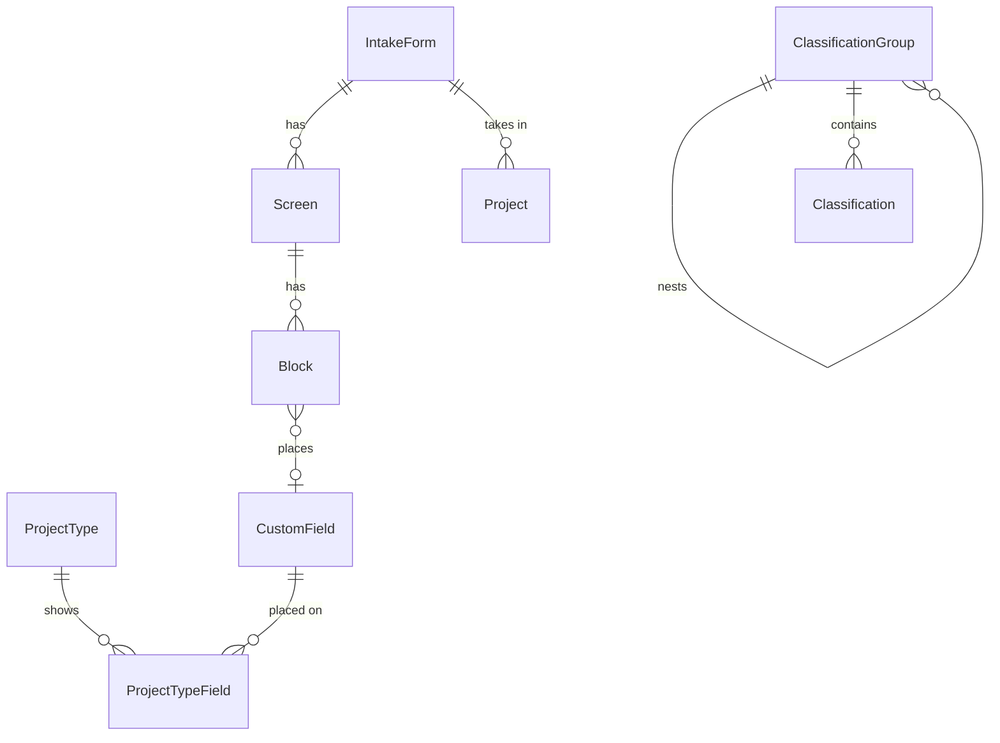
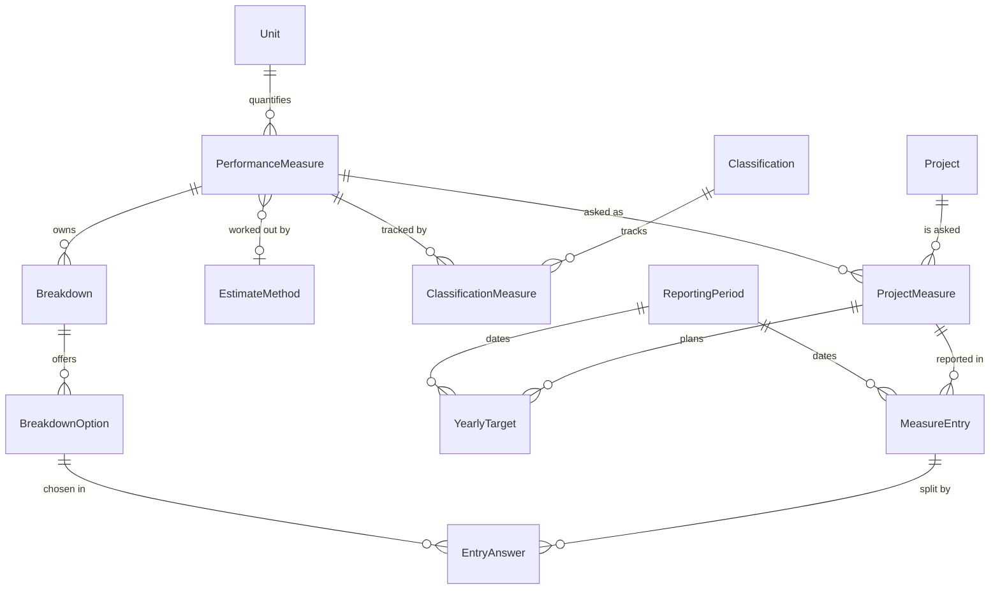
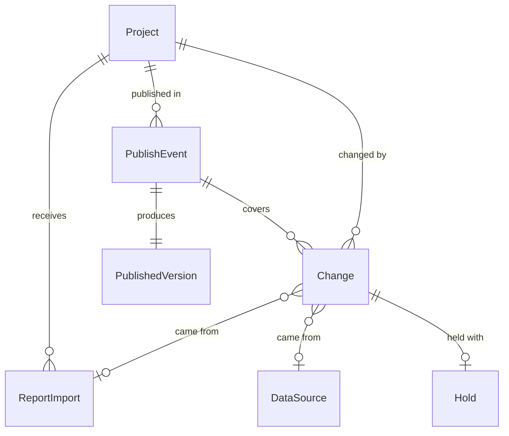
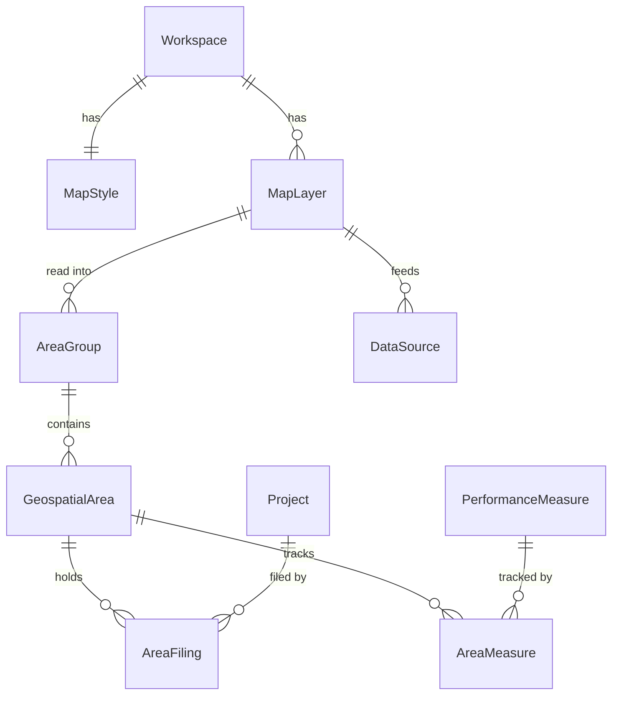
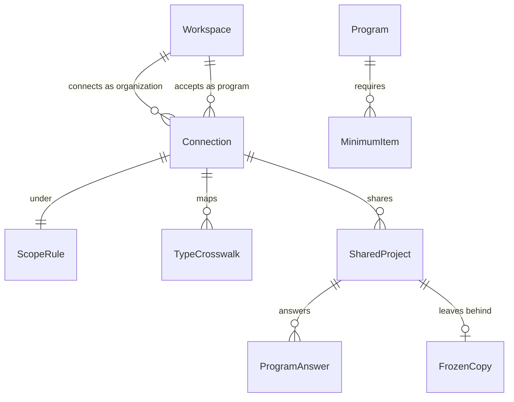

# Data model

Updated: 2026-11-24

The entities the prototype implies, how they relate, and where the prototype
disagrees with itself. It is read off what is built, not designed ahead of it.

**Built from:** every exported type in `src/data/` and `src/lib/`, the route
list under `src/pages/prototypes/`, `GLOSSARY.md`, `.scratch/system-map.md`,
the specs under `.scratch/`, `docs/measure-model.md`,
`docs/roles-and-permissions.md` and ADR 0002. Components were not read, so a
field that exists only in a component's markup is missing here.

**How to read it**

- Names follow the glossary. Where the code uses another name, the code name is
  in backticks.
- Each entity carries a status:
  **Built** (a type and a screen exist), **Specified** (a spec decides it, no
  type yet), **Settled** (decided for this model, see [Settled](#settled); the
  prototype's types do not have it yet).
- The prototype keys almost everything by `slug` or by display name. Every
  entity below needs a stable id that a rename does not change. That is assumed
  throughout and not repeated per table.
- Mock values are invented. Nothing here comes from a client's data.

## The whole model at a glance

The spine: a **workspace** holds **organizations** and **people**; an
organization leads **projects**; a project is filed under **classifications**,
which track **performance measures** with targets; the project reports
**entries** against the measures it is asked. Every edit is a **change** with a
source, and the public reads only a **published version**.

---

## 1. Workspace, people and access

| Entity | Status | Attributes | Notes |
|---|---|---|---|
| **Workspace** | Built | name, address (subdomain), contact email, fiscal year start month, brand colour, AI reading (off / on / unavailable, with who and when) | The tenant. Maps to an Auth0 Organization. `workspaceGeneral`, `TenantBrand`, `AiReading`. |
| **User** `WorkspaceUser` | Built | name, email, role (Administrator / Contributor / Viewer), status (Active / Invited / Suspended), last active | One fixed role per workspace. |
| **Membership** | Built as two arrays | user, organization, is manager | `organizations[]` and `managerOf[]` on the user. A Contributor has at least one; a Viewer can never be a manager. |
| **Organization** | Built | name, type (seven kinds), website, description, primary contact, visibility (public / workspace / private), joining (open / invite / approval), review cadence, added by, requested by, created | `projectsLed`, `projectsFunded`, `people` are counts, derived. "Verified" derives from a verified domain matching the website. |
| **Approved domain** | Built | domain, status (verified / pending), verifying email, date | Belongs to an organization. |
| **Access request** | Built | kind (join / organization), requester name and email, organization (existing, or a name, type and website for a new one), asked (Contributor / Viewer), message, created, status (pending / approved / declined / withdrawn), granted, reason, answered by, answered on, raised from (welcome / project / intake), project | One entity, two kinds. |
| **Permission setting** | Built | action (invite people, create projects, manage classifications, set project targets, publish projects, import, export, create API tokens), audience (admins / managers / editors) | Workspace-wide "who can". An organization has its own set (manage members). Roles themselves have no settings. |
| **Personal settings** | Built (screens only) | profile, colour scheme, underline links, pointer cursors, notification choices | Per user. Only the interface preferences have types. |

Rules that shape the schema:

- Role is on the user; manager is on the membership. Never a custom role.
- A Contributor edits projects **led** by an organization they belong to.
  Funding a project gives no edit rights, so "leads" and "funds" must stay two
  different relationships.
- Request surfaces never expose who the managers are, so a request's routing
  target is a role, not a person.

## 2. The project record

| Entity | Status | Attributes | Notes |
|---|---|---|---|
| **Project** | Built | name, description (rich text, files inline), type, lead organization, stage, county (until a county layer makes it an area group), implementation start year, completion year (optional), estimated total cost, estimated annual operating cost, map centre and zoom, source (app / subscribed) | `Project` + `ProjectDetail`. |
| **Work area** | Built, two shapes; Settled as one | id, label, kind (area / reach / point), path, extent, unit (acres / miles), origin (record / drawn / coordinates / reference / upload), adopted from, description, colour | The `MapWorkArea` shape. Shape changes only from spatial data. |
| **Funding source** | Built (list and record; adding and editing one are not) | name, funding organization, description, accepting requests (yes / no), closing date (optional), its custom field values | Money one organization offers that can fund many projects: a grant, an award, an appropriation, a call for proposals. Workspace-level, with its own list and record. While it accepts requests, a project can ask it for money; after the closing date it is no longer offered and existing requests stay. `src/data/firma2-funding-sources.ts`. |
| **Project funding** `ProjectFunding` | Built; amounts by year Settled | project, funding source, status (requested / secured / not awarded); amount and share are derived | One row per funding source on a project, with one status for the whole row: a source is never part secured and part requested. A requested row is an application for that money. Every funding total counts secured rows only. The funder is read from the funding source, never typed again. |
| **Funding year** | Settled | project funding, year, amount | What the funding source puts in that year. The row's amount is the sum of its years. Today the row carries one amount and no years. |
| **Expenditure** `ExpenditureYear` | Built by year only; Settled by funding source and year | project, funding source, year, amount spent, status (complete / current / upcoming) | What was spent from one funding source in one year. The project's spend for a year is the sum across its funding sources. |
| **Related organization** | Settled | project, organization | An organization named on the project that neither leads nor funds it. A plain list: no role, no permissions, no effect on who can edit. Lead and funder stay the only first-class relationships. |
| **Milestone** | Built | date, title, status (complete / current / upcoming / halted) | |
| **Project contact** | Built; user link Settled | name, role on the project, organization, email, user (optional) | Linked to a workspace user when the email matches. Otherwise a name and email with no account. |
| **Comment** | Built | author, date, body | |
| **Photo** | Built | file, caption, alt text, credit, stage (before / during / after), taken on, public (yes / no), featured (one per project), position in the order | `ProjectPhoto`, `ResolvedPhoto`. Stage is stored, never read from the date. |
| **Photo point** | Built as a string; Settled as a row | project, name | A before and an after at one point make a pair (derived). |
| **Collection** | Built as a string; Settled as a row | project, name, order of its photos | A photo is in at most one. |
| **Custom field value** | Settled | owner (a project or a funding source), field, value | A first-class part of the record: every custom field answer is one row, typed by the field's kind. Today only the spreadsheet import stores them (`ImportedProject.custom`). A change to one is a Change like any other field. |

## 3. What an administrator sets up

| Entity | Status | Attributes | Notes |
|---|---|---|---|
| **Project type** | Built | name, colour, description, guidance, which fields it shows and where (rail / details), section order and hidden sections | Optional on a project, not required. |
| **Stage** `StageSetting` | Built | name, description, icon, colour, order, reports yearly, has a public page | Where the work is in its life, and nothing else. The stage decides whether its projects are public and whether they owe yearly reports. Proposal stays a stage: work that is proposed and not yet committed. |
| **Custom field** `FieldDefinition` | Built | label, kind (choice, multi-choice, yes-no, number, money, date, text, long text), options, unit, help text, range, guidance per option, chooser (a short question tree that picks an option), required, applies to (project or funding source) | Made once in Custom fields. Types and the intake form place it; they never make it. |
| **Classification group** | Built | name, description, colour, icon, parent group | Nests to any depth. No measures or targets of its own; no project filed on it directly. |
| **Classification** | Built | name, description, colour, icon, group | Always in a group. Carries the measures it tracks and their targets (section 4). |
| **Intake form** | Built | title, after-submit message, accepting new projects (yes / no); screens (title, show-when condition); blocks (a built-in question, a placed custom field, or free text; each with label, help, placeholder, required) | One per workspace. With the switch off, only administrators add projects. |
| **Admission** `IntakeProject` | Built: stage is asked at intake and the status is independent of it. Still a separate record in the prototype's storage | admission status (draft / submitted / returned / approved / declined), entered by and on, submitted on, decided by and on, return comment | Whether the record is in the inventory yet. Independent of stage: a project already in Implementation can be waiting for approval. Only an approved project counts in reports or shows on the public map. The noun "proposal" is not used for this. |

## 4. Performance measures

One model, reconciled from the prototype's two (see
[How the two measure models were reconciled](#how-the-two-measure-models-were-reconciled)).
This section replaces "The model" block in `docs/measure-model.md`, which still
describes the shape from before 2026-10-09; the evidence in that document
stands.

| Entity | Attributes | Notes |
|---|---|---|
| **Performance measure** | id, slug, name, claim (the sentence it lets the workspace say), definition, reporter guidance, unit, decimal places, counting rule (sum / no-sum), status (Draft / Published / Retired), source (reported / estimated), estimate method | Flat: one unit and one counting rule per measure. No theme. |
| **Unit** | id, name, abbreviation, quantity (area / length / none) | A closed, global list. The quantity says whether work areas can measure it. |
| **Breakdown** | id, measure, question, order, retired | Owned by its measure; no shared lists. Optional at entry. |
| **Breakdown option** | id, breakdown, name, order, retired | Every breakdown carries "Unspecified". A retired option still reads on past entries and is not offered for new ones. |
| **Reporting period** | id, name, start date, end date | Workspace-wide. Seeded as calendar years. The name is what screens show. |
| **Classification measure** | classification, measure, target value, target year | Set from the classification side only. The target is optional. |
| **Project measure** | project, measure, lifetime target | One target per measure on a project, never one per breakdown option. Exists when a classification of the project tracks the measure, or the project has a target or an entry for it. |
| **Yearly target** | project measure, period, planned | Optional. Need not add up to the lifetime target; the page says when it does not. |
| **Measure entry** | id, project measure, period, value | The unit of reporting. A project can file several in one period. |
| **Entry answer** | entry, breakdown, option | At most one option per breakdown; none is legitimate. |
| **Estimate method** | id, name, version, unit, quantity (acres), coefficient unit, coefficients by practice and region | For `estimated` measures. A new version is a new edition, never a silent change. |

Rules that shape the schema:

- A cumulative total and a per-period sum are legal only for `sum` measures.
- A measure links to another, or adds up across organizations, only when the
  counting rules match.
- An estimated measure takes no entries and no targets.
- A measure whose unit is a size also shows what the work areas add up to. That
  figure is derived and never stored as an entry.
- A year's figure, a to-date total and a breakdown total are all added up from
  entries. None is stored.
- Who may set a project's target is the workspace's "Set project targets"
  setting (administrators by default). Anyone who can edit the project can file
  an entry.
- Every write to a target or an entry is a Change (section 5).

### How the two measure models were reconciled

"Main" is `src/data/firma2-performance-measures.ts` with the project page's
entries and targets. "PM 2" is `src/data/firma2-pm2.ts`, the port of
ProjectFirma2's own build. They were brought together once already on
2026-10-09; this table closes what was left.

| Point | Main | PM 2 | This model | Why |
|---|---|---|---|---|
| Identity | slug; a project's seeded measures keyed by name | numeric ids throughout | id on every row, slug kept for addresses | A rename must not orphan entries. |
| Theme | none | theme per measure | none | Dropped 2026-10-09: it repeated classifications. |
| Link to classifications | a classification tracks measures, with a target | none | Main's | It carries the goal's target and decides what a project is asked. |
| Unit | 19 names | 23 rows with id and abbreviation | PM 2's shape, both lists merged (25) | See the note below the table. |
| Decimal places | per measure | none | Main's | A count and a temperature do not round alike. |
| Counting rule, status, claim, guidance | same | same | same | Already reconciled. |
| Breakdown options | names in a list | rows with id and order | PM 2's rows, plus Main's `retired` | Ids survive a rename; retiring keeps history readable. |
| After publishing | options and questions can be added, moved and retired | breakdowns are locked | Main's | Decided 2026-10-09. A published measure cannot drop a question its entries answer, so it retires it. |
| Entry | year, answers keyed by the question's words | period id, option ids | PM 2's | Same atom in both; ids are the durable form. |
| Period | calendar year, bridged to a period | period id | PM 2's | Main already seeds the same period records. |
| Which measures a project is asked | those its classifications track; a row with a target or entries never hides | every published measure; a target attaches it | Main's | Decided 2026-11-12. PM 2's rule asks every project every question. |
| Target | lifetime, plus a plan per year | lifetime only | Main's | Decided 2026-10-09: a short year reads against that year's plan. |
| Estimated measures | `source: estimated` with a method | none | Main's | Added 2026-11-12. |
| Change log | `MeasureChange` | `Pm2Change` | the one Change in section 5 | Same rows; one log for the whole record. |

**Units.** PM 2 has six that Main lacks: inches, millimeters, acre-feet,
acre-feet/acre, degrees Fahrenheit, cubic yards. Main has two that PM 2 lacks:
acre-feet per year, tonnes CO2e per year. The merged list keeps all 25.

How a yearly plan relates to the lifetime target, and the merged unit list,
are [Settled](#settled) decisions 5 and 6.

## 5. Changes, sources and publishing

| Entity | Status | Attributes | Notes |
|---|---|---|---|
| **Change** | Settled; built as four shapes | id, project, subject (a field, a custom field value, a measure entry, a target, a funding row, a contact, a work area, a photo), action (set / add / remove), from, to, by, at, source (by hand / a named document / a named data source), the report import or data source it came from, and for a document its quote, passage and page; reverts (the change it undoes) | One row per write, whatever the subject and however it arrived. Replaces `AuditEntry`, `MeasureChange`, `Pm2Change` and `ImportedChange`. The change log, the review's net difference and the Updates feed all read this one table. |
| **Report import** | Built | project, by, at, document name and kind (file / sample / text), note to the manager, the changes it added | The file itself is not kept. The name and the quoted words are. One Undo covers the whole import. |
| **Publish event** | Built | project, kind (publish / undo), by, at, which changes it covered | `PublishEvent`, `LocalPublish`. |
| **Published version** `PublishedSnapshot` | Built | the record as the public reads it: key facts, description, stage, and what is withheld (measure reports, funding rows) | The public site, reports and Viewers read this, never the live record. |
| **Hold** `ReviewNote` | Built | change, note (required), by, at, who was told | A held value stays on the record and returns in the next review. A revert needs a reason too. |
| **Review cadence** | Built | none / monthly / quarterly / twice-yearly / yearly | Per organization. |
| **Data source** | GIS kind built; others specified | name, owner level (workspace / organization / project), kind, mapping of its fields to project fields, authoritative (yes / no), active, last success, last message | `Subscription` is the workspace-level GIS kind: layer, join field, feature id field, label field, default lead, type and stage for new projects. |
| **Import batch** | Built | file name, at, projects created, projects updated, organizations added | The spreadsheet import of many projects. |

Rules that shape the schema:

- Every edit saves to the live record at once. There is no update request
  entity.
- Nothing publishes because time passed. A workspace-level data source is the
  one thing that publishes itself.
- One owner per field: an authoritative source locks the fields it supplies.
- The net difference shown in review (`UnpublishedChange`) is computed from the
  changes since the last publish event. It is not stored.

## 6. Maps and geography

| Entity | Status | Attributes | Notes |
|---|---|---|---|
| **Map style** | Built | base map, area colour, reach colour, fill opacity, colour-by | One per workspace. |
| **Map layer** `ReferenceLayer` | Built | name, kind (feature / map / WMS / GeoJSON), URL, service layer, description, popup field, minimum zoom, on by default, active, stroke, fill, line style, labels, fields | An uploaded file becomes a layer too. |
| **Area group** | Built | name, description, colour, layer, name field | One field of one layer names its areas. |
| **Geospatial area** | Built | name, shape, acres, description, colour | One shape of the layer. |
| **Area filing** | Settled | project, geospatial area | Computed, stored, never edited by hand. |
| **Area measure** | Specified | area, measure, target value, target year | Geospatial-areas spec, decision 3: same shape as a classification measure. |

A project is filed under a geospatial area **by where its work areas fall**.
Nobody picks it. The result is stored as **Area filing** (project, area) and
recomputed when a work area's shape or the area's layer changes.

## 7. Pages, dashboards and the public site

| Entity | Status | Attributes | Notes |
|---|---|---|---|
| **Custom entry** | Built | kind (folder / page / document / dashboard), title, folder, order; a page has a body, a document has one file, a dashboard has a template | One tree. Folders do not nest. |
| **Page file** | Built | page, kind (inline / attachment / document), name, type, size, added | Files show inline in the body only. |
| **Dashboard** | Built | name, scope, tiles | The Progress Dashboard is the first one. |
| **Tile** `TileState` | Built | measure or figure, split, scope, from year, attribution (full / share), view (year / cumulative), kind (chart / number / groups), span, height | |
| **Saved view** | Built | name, filter, shared with (organization / only me), created by, organization | A stored filter over the project grid. |
| **Organization report** | Built | name, scope, year, format, owner | Coverage (due, reported, gaps) is derived. |
| **Public site config** | Built | access (public, contacts shown), identity (name, logo, icon, share text and image), announcement, home sections and their order, navigation order, labels and links, theme (fonts, bar, hero, accent), footer; draft and published copies | One per workspace. Draft then publish. |
| **Terminology** `Vocabulary` | Built | noun, the workspace's singular and plural | Renames the product's nouns. |
| **Menu order**, **Grid defaults** | Built | order of navigation items per section; column order and hidden columns per grid | Workspace level. A person's own grid changes sit on top. |

## 8. Programs and connected organizations

Specified in `.scratch/connected-orgs/spec.md` and ADR 0002. Only the program
section on the project page is built (`firma2-program-requirements.ts`).

| Entity | Status | Attributes | Notes |
|---|---|---|---|
| **Connection** | Specified | organization workspace, program workspace, state, extra fields shared, other funders' amounts shown | Makes a workspace appear as a connected organization in a program. |
| **Scope rule** | Specified | project types wanted, "and funded by us" | |
| **Minimum item** | Built | core fact (name, type, work areas, timeline, stage, description), or a program field (label, control, options, owner: organization / program), or a measure per project type | `Program.coreFacts`, `ProgramField`, `measuresByType`. Funder-owned fields are edited by the program only. |
| **Type crosswalk** | Specified | organization's type, program's type or "not in this program" | Field and measure crosswalks come later, only where counting rules match. |
| **Shared project** `ProgramShare` | Built | project, program, answers to the program's fields, complete (derived) | One record, never a copy. |
| **Frozen copy** | Specified | the last published version and its history | Kept by the program when a share stops. |

---

## Derived, never stored

| What a screen shows | Worked out from |
|---|---|
| Classification and group totals, per-measure progress, funders (`ClassificationRollup`, `GroupRollup`, `KpiProgress`) | Projects filed beneath, each counted once; their entries, targets and funding |
| Which measures a project is asked | Its classifications' measure links |
| A project's funding gap | Estimated total cost, less its secured and requested funding |
| A funding row's amount, a year's spend for the whole project | Funding years; expenditures across funding sources |
| Review queue, backlog, waiting days, the net difference | Changes since the last publish event; the organization's cadence |
| Area filing (stored once worked out) | Work area shapes against layer shapes |
| "Measured from the work areas" | Work area extents, for size units |
| An estimated figure | Work areas, classifications, the method's coefficients |
| Reporting coverage and gaps | Stages that report yearly, entries filed per period |
| Organization "verified" | A verified domain matching its website |
| Before-and-after pair, the public lead photo | Photos at one photo point; featured, else the newest public photo |
| Dashboard figures (`Dataset`, `Figure`) | Everything above |

## Settled

Decided by the user on 2026-11-24, 7 to 14 by accepting this document's
proposals. 18 to 21 and the second amendment to 7 came from reading a real
workspace's export against this model. The prototype's types do not reflect these yet.

**In the prototype as of 2026-11-24:** 1, 6, 7, 12, 14, 15 and 16, and the single role type from 13. **Not yet in the prototype:** 2 (ids on measures, options and entries; the PM 2 comparison pages still stand), 3 (one Change entity), 4 (custom field values on the record), 5 (the page saying when yearly plans do not add up), 8, 9, 10 and the single work area shape from 13.

| # | Decision |
|---|---|
| 1 | **Funding source is an entity.** A workspace keeps a list of funding sources, each offered by one organization. A project's funding row links to one and carries the amount. Funding source fields are custom fields whose values belong to the funding source. |
| 2 | **One measure model**, section 4, reconciled from Main and PM 2 as its table records. |
| 3 | **One Change entity**, section 5: one row per write, with its source, for every part of the record. |
| 4 | **Custom field values are part of the record**: one row per answer, on a project or a funding source. |
| 5 | **Lifetime target and yearly plans.** The lifetime target is the stored commitment. Yearly plans are optional. For a `sum` measure the page says when they do not add up to the target, and never blocks. A `no-sum` measure has yearly plans only, where a lifetime figure means nothing. |
| 6 | **The unit list keeps all 25**, the four legacy hydrology units included: a missing unit is a measure the product cannot express. |
| 7 | **A funding row says whether its money is requested, secured or not awarded**, and totals count secured only. *Amended 2026-11-24: the status returns so that a request for funding needs no entity of its own. Amended again 2026-11-24, from a real workspace's export: money is kept by year. A funding row holds an amount per year, and spend is recorded per funding source and year. The row still has one status; a source is not split into a secured part and a requested part.* |
| 8 | **Photo points and collections are rows** owned by the project. A photo links to at most one of each; renaming one touches one row. |
| 9 | **A project contact stays its own row**, with an optional link to a workspace user when the email matches. No account is created for a contact. |
| 10 | **Area filing is stored**: one row per project and geospatial area, recomputed when a work area's shape or the area's layer changes. Nobody edits it. |
| 11 | **County stays a plain field** on the project until a workspace has a county layer; then it is an area group and the field goes. |
| 12 | **Stage and admission are two facts on one project.** Stage says where the work is (Proposal, Planning & Design, Implementation and so on). Admission status says whether the record is in the inventory: draft, submitted, returned, approved, declined. Entering a project never creates a separate "proposal" record, and a project is called a proposal only when its stage is Proposal. A project counts in reports and on the public map once it is approved, whatever its stage. Deferred stays a stage (work on hold); an entry that is turned down is declined, not deferred. Confirmed by the user 2026-11-24; replaces the earlier wording of this decision. |
| 13 | **One work area shape** (`MapWorkArea`: id, point kind, origin) and **one role type**. |
| 14 | **"Program" means only the workspace** other organizations report to. The fund name on a funding row is the funding source's name. |
| 15 | **An administrator decides whether the workspace is accepting new projects**: one switch on the intake form. Off, only administrators add projects. |
| 16 | **A funding source can accept requests until a closing date.** The date governs submitting, not starting a draft. This, with decision 7, is how a call for proposals is run. |
| 17 | **No Solicitation, Application or Review entities.** One client runs scored calls for proposals; it is served by decisions 7, 15 and 16, a custom field for the outcome score and a saved view for the slate. Revisit when more clients need per-reviewer scoring or answers kept per application. |

| 18 | **Related organizations are a plain list on the project.** Any organization can be named on a project as related. It carries no role and no permissions. Only lead and funder are first-class. A legacy "implementer" or "other partner" migrates as related. |
| 19 | **The funding gap is derived**: estimated total cost less secured and requested funding. Funding rows no longer have to add up to the cost. |
| 20 | **Completion year is optional.** A deferred project may have none. |
| 21 | **One target per measure on a project.** No target per breakdown option. A split that is a real commitment is two measures. Confirmed by the user 2026-11-24: this is the model as built. On migration, legacy split targets that repeat one value keep that value, differing ones are added, and both are flagged for a person to confirm. |

## Open points

None. Every point this document raised is in [Settled](#settled). The next
ones will come from building against it.

## Left out on purpose

- The PM 2 comparison types (`Pm2*`): folded into section 4.
- `team-5` sandbox types (`ChangeRow`, `Attachment`, `UpdateTarget`,
  `PhotoTiming`): to be deleted (project-updates spec, decision 39).
- Prototype scaffolding: flows, help articles, glossary terms, changelog,
  recently viewed, demo switches.
- View models that only shape data for one component (`MeterView`,
  `KpiRowView`, `TreemapRect` and the like).
- `RealProject` / `RealWorkspace`: the shape of a pulled ProjectFirma 1 tenant,
  used in dev only. It is the migration source, not this product's model.
